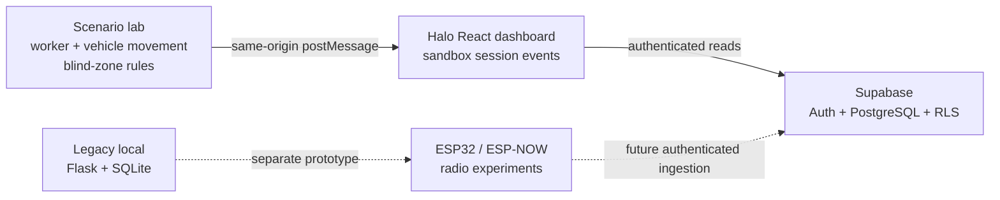

<div align="center">

# 🦺 Halo Safety

**From proximity detection to context-aware worker safety.**

A prototype platform for exploring how wireless sensing, vehicle blind zones, and event monitoring can help reduce struck-by hazards around heavy equipment.

**natHacks 2026 · Construction & Manufacturing**

[**Open Halo**](https://halo-safety.vercel.app) · [**Explore the simulation**](https://halo-safety.vercel.app/#simulation) · [**Project roadmap**](roadmap.md) · [**GitHub contributions**](https://github.com/Halo-Safety/halo-safety/pulls)


<sub>The web application requires an invited account. The scenario simulator is a test environment, not a live safety monitor.</sub>

</div>

---

## Contents

- [About the project](#about-the-project)
- [The problem](#the-problem)
- [Our approach](#our-approach)
- [What works today](#what-works-today)
- [How it works](#how-it-works)
- [Technical stack](#technical-stack)
- [Try the demo](#try-the-demo)
- [Run locally](#run-locally)
- [Challenges and what we learned](#challenges-and-what-we-learned)
- [What's next](#whats-next)
- [Repository structure](#repository-structure)
- [Team and acknowledgements](#team-and-acknowledgements)
- [Safety and sources](#safety-and-sources)

---

## About the project

Halo is a **vehicle-to-worker safety monitoring concept** developed for construction and industrial environments where people work near mobile machinery. Rather than treating a radio proximity threshold as the whole solution, Halo explores how the **worker's location relative to the vehicle**, **configurable blind zones**, and **equipment operating context** could produce more meaningful warnings for workers and operators.

Our hackathon work combines an interactive browser scenario lab, an authenticated monitoring dashboard, an early event-data model, and experiments involving ESP32 wireless communication and RSSI-based ranging.

<details>
<summary><b>Project summary — click to expand</b></summary>

<br/>

**Problem.** Heavy vehicles have blind spots, and workers on foot may be difficult for an operator to see. General audible alarms can be hard to interpret on busy sites. Halo investigates how context-aware warnings might supplement established worksite safety practices.

**Approach.** The proposed system uses wireless devices attached to workers and vehicles. Multiple vehicle-side measurements could support approximate relative positioning; contextual rules would evaluate whether a worker is entering a relevant hazard zone, and eventually notify both people involved. The current browser simulator models the motion and zone logic without claiming to reproduce real-world radio accuracy.

**Results to date.** The team developed simulated danger events and a local event-logging proof of concept. The current React application provides sign-in, organization-scoped event views, scenario playback, and a separately labeled sandbox event history. End-to-end hardware-to-cloud alert delivery has **not** yet been completed or validated.

**Next steps.** Integrate and test the physical warning devices; measure radio ranging error and end-to-end warning latency; then develop an authenticated event-ingestion path and richer safety analysis.

</details>

## The problem

Struck-by hazards are a major concern in construction. According to [NIOSH's 2024 review](https://www.cdc.gov/niosh/bulletin/2024/struck-by.html), struck-by events are the leading cause of nonfatal injuries and the second most common cause of fatalities among construction workers. Among fatal occupational injuries at road construction sites from **2011–2022**, **44% (650 of 1,462)** involved a worker struck by a vehicle in a work zone.

Blind areas vary by vehicle, operator position, and site conditions. A single distance threshold may warn about some nearby workers but provides little information about *which part of the vehicle is hazardous* or *whether the equipment is moving toward that worker*.

Our goal is to explore a more informative warning system—not to replace traffic-control plans, trained spotters, existing safety procedures, or certified protection equipment.

## Our approach

Halo is designed around three connected ideas:

1. **Sense proximity and relative position.** Explore ESP32 wireless links, RSSI filtering, and potentially multiple vehicle-mounted anchors for approximate worker positioning.
2. **Interpret the situation.** Associate positions with configurable vehicle blind zones and, eventually, validated equipment motion information to decide when a warning is relevant.
3. **Warn and learn.** The proposed physical system would alert both the worker and operator. Recorded sensor events could later support investigation, trend analysis, and corrective actions.

**The distinction matters:** precise trilateration, reliable direction detection, physical alert actuation, and automated machine stopping are **not demonstrated production capabilities** of the current repository. The Python code contains a standalone least-squares positioning experiment, not a validated field-positioning system.

## What works today

| Component | Current status | Scope |
| --- | --- | --- |
| React monitoring workspace | **Implemented** | Overview, recorded-event metrics, active-warning reconstruction, seven-day trend, event history |
| Supabase authentication | **Implemented** | Email/password sign-in, session management, and password recovery |
| Organization-scoped data model | **Implemented** | PostgreSQL schema and row-level security policies for reading organization events |
| Scenario lab | **Implemented (simulation)** | Move workers and equipment, define blind zones, trace routes, set speeds, run and pause scenarios |
| Simulated warning activity | **Implemented (browser-only)** | Warning/clear transitions appear in a separate local-session timeline and Overview summary |
| Local Flask + SQLite prototype | **Experimental / legacy** | Separate local endpoints and a serial-reader foundation for test events |
| ESP32 / ESP-NOW ranging | **Hardware exploration** | Team experiments with wireless links and noisy RSSI measurements; not a verified production pipeline |
| Multi-anchor positioning | **Algorithm prototype** | Standalone Python least-squares estimate; not integrated or accuracy-validated |
| Physical worker/driver alerts | **Integration pending** | Vibration, buzzer, and lights are part of the intended hardware response |
| Secure device-to-cloud ingestion | **Not yet implemented** | The deployed dashboard reads events; it does not securely accept device events yet |
| Heatmaps, investigation reports, corrective actions | **Planned** | Longer-term site-safety intelligence workflows |

> **Important:** An alert emitted by the simulator is an illustrative test event, **not a confirmed near-miss or real-world safety incident**. Simulation data are not inserted into Supabase and do not increase recorded sensor-alert counts.

## How it works

### Current software architecture



The React frontend is deployed with **Vercel**. Signed-in users can read events belonging to their organization through Supabase row-level security. The event dashboard refreshes on a three-second interval.

The **Simulation** tab contains a browser-based geometry engine. The worker and vehicle can follow user-defined routes while hazard regions move with the vehicle. The simulator notifies the surrounding Halo interface when a warning starts or clears. Those notifications are kept in browser memory and stay separate from real event records.

The older **Flask/SQLite** backend remains in the repository for local experiments. Its ingestion endpoints are **not protected by the Supabase login** and must not be exposed as public production APIs.

### Intended hardware pipeline (future integration)

```text
Worker wearable (ESP32) ←→ Vehicle unit (ESP32)
          |                    |
      Vibration          Buzzer / LEDs
          └── Local alerts, independent of the web dashboard
                                 |
                   Authenticated event ingestion (planned)
                                 |
                       Halo event monitoring
```

RSSI is a noisy indicator of signal strength, **not a guaranteed metre-accurate range measurement**. The intended design needs calibration, smoothing, filtering, disconnection handling, and controlled testing before hazard decisions can be trusted.

## Technical stack

| Layer | Technology |
| --- | --- |
| Web interface | React 19, TypeScript, Vite, CSS, Lucide icons |
| Web hosting | Vercel |
| Authentication | Supabase Auth |
| Data storage / authorization | Supabase PostgreSQL, row-level security |
| Browser simulator | JavaScript, SVG, route and hazard-zone geometry |
| Legacy local services | Python, Flask, Flask-SocketIO, SQLite, pySerial |
| Hardware research | ESP32 microcontrollers, ESP-NOW, RSSI ranging |
| Positioning experiment | Python, NumPy, SciPy least-squares |

## Try the demo

[**Launch the Halo application**](https://halo-safety.vercel.app)

An **invited account** is required to sign in. The app does not provide anonymous access or a fake demo login.

1. Sign in and open **Simulation** from the workspace sidebar.
2. Move the worker into a blind zone, or plan a worker path and vehicle path with chosen speeds.
3. Run the scenario and observe the driver/worker warning panels.
4. Inspect the simulated alert and clear events in **Simulation activity**.
5. Return to **Overview** to see the separate sandbox summary. The recorded production-event charts and table remain unaffected.

The browser scenario and its local event history reset when the page is reloaded.

## Run locally

### React frontend

Prerequisites: Node.js and npm, plus a configured Supabase project if you need to sign in.

```bash
git clone https://github.com/Halo-Safety/halo-safety.git
cd halo-safety/frontend
npm install

# Copy .env.example to .env.local and fill in your public Supabase values.
npm run dev
```

Set these in `frontend/.env.local` (or the corresponding Vercel environment settings):

```dotenv
VITE_SUPABASE_URL=https://YOUR-PROJECT.supabase.co
VITE_SUPABASE_PUBLISHABLE_KEY=YOUR_PUBLIC_CLIENT_KEY
```

For first-time setup, apply [`supabase/schema.sql`](supabase/schema.sql) in the Supabase SQL editor, create an organization, and associate invited users with it. See [`frontend/AUTH_SETUP.md`](frontend/AUTH_SETUP.md) for the full setup, redirect URLs, and access-control steps.

**Never place a Supabase `service_role` key or other server secret in a `VITE_` environment variable.** These variables are bundled into client-side JavaScript.

### Standalone simulator / legacy backend

The original simulator can also be run separately: see [`halo_nat/Halo-Simulator/Halo-Simulator/README.md`](halo_nat/Halo-Simulator/Halo-Simulator/README.md).

The older Flask backend is located at [`halo_nat/app.py`](halo_nat/app.py) and uses [`halo_nat/requirements.txt`](halo_nat/requirements.txt). Treat it as a **local experimental service only**. It is not the authenticated API behind the deployed React dashboard.

## Challenges and what we learned

Our team explored both wireless embedded systems and web platform development:

- **Radio interference.** RSSI fluctuates with obstruction, device orientation, and nearby metal. Averaging repeated readings can reduce short-term variation, but does not make RSSI a precise distance sensor.
- **Position estimation.** Trilateration requires useful distance estimates from multiple known anchor positions. A mathematical solver alone does not establish field accuracy; timing-based ranging was also explored conceptually, but has not been validated here.
- **Contextual warnings.** A visible simulation makes it easier to reason about moving vehicles, blind sectors, and when a warning should start or clear before putting those rules on physical devices.
- **Frontend/backend boundaries.** The project evolved from a local Flask dashboard to a deployed React application with Supabase authentication and an organization-scoped data model. A secure production event-ingestion service remains separate work.
- **Team integration.** Bringing together firmware experiments, a teammate's simulator, and web deployment highlighted the importance of clear interfaces, realistic scope, and careful version-control collaboration.

## What's next

The next development stages are:

1. **Close the hardware loop:** demonstrate repeatable ESP32 communication, calibrated RSSI-based proximity decisions, worker vibration, and operator alerts independent of the dashboard.
2. **Measure and document performance:** test different positions, orientations, obstacles, missed packets, false alarms, and end-to-end warning latency. The earlier under-100-ms goal remains a **test target**, not a measured claim.
3. **Connect devices securely:** implement authenticated server-side event ingestion and organizational association without exposing privileged credentials to browsers.
4. **Improve contextual detection:** evaluate multiple anchors, conservative blind-zone matching, machine-motion inputs, and possibly UWB-based ranging.
5. **Develop safety intelligence:** investigate alert histories, group related events, identify recurring risk patterns, and track proposed corrective actions.
6. **Validate before deployment:** conduct controlled field testing, engineering reviews, and a safety assessment before any reliance on physical warning or machine-interlock behavior.

Our detailed work breakdown is maintained in [`roadmap.md`](roadmap.md).

## Repository structure

```text
halo-safety/
├── frontend/
│   ├── src/                  # React application, auth, event views
│   ├── public/simulator/     # Embedded browser scenario lab
│   ├── AUTH_SETUP.md         # Supabase setup and security notes
│   └── README.md             # Frontend-specific instructions
├── supabase/
│   └── schema.sql            # Organizations, memberships, sensor events, RLS
├── halo_nat/
│   ├── app.py                # Legacy local Flask API
│   ├── database.py           # Legacy SQLite event storage
│   ├── serial_reader.py      # Experimental serial event reader
│   ├── locator.py            # Standalone trilateration experiment
│   └── Halo-Simulator/       # Original standalone simulator
├── roadmap.md                # Project planning and validation milestones
└── README.md                 # You are here
```

## Team and acknowledgements

**Halo Safety — natHacks 2026.** The project was developed collaboratively across embedded-systems exploration, scenario simulation, frontend development, research, and documentation.

See the [repository contributors](https://github.com/Halo-Safety/halo-safety/graphs/contributors) and [pull request history](https://github.com/Halo-Safety/halo-safety/pulls?q=is%3Apr) for the code contribution record.

We thank the natHacks organizers and the teams who contribute open safety research and construction equipment visibility guidance.

## Safety and sources

> **Research prototype — not certified safety equipment.** Halo is not an industrial safety controller, does not provide verified real-time collision prediction, and must not be relied upon to protect workers or stop machinery. Existing workplace controls and qualified safety procedures remain essential.

- [NIOSH (2024): Using Internal Traffic Control Plans to Prevent Construction Worker Injuries and Fatalities in Work Zones](https://www.cdc.gov/niosh/bulletin/2024/struck-by.html) — construction struck-by context and historical statistics.
- [NIOSH: Construction Equipment Visibility](https://www.cdc.gov/niosh/bulletin/2011/visibility.html) — vehicle blind-area research and visibility diagrams.
- [Halo project roadmap](roadmap.md) — intended MVP boundaries, validation work, and future improvements.

---

<div align="center">

**Halo Safety · Explore risks. Test scenarios. Build safer systems.**

[Back to top](#-halo-safety)

</div>
